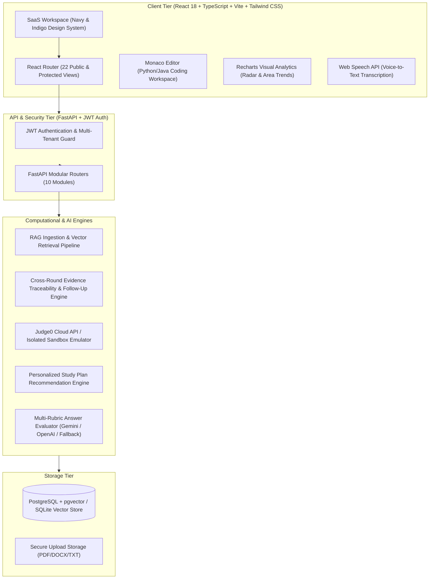
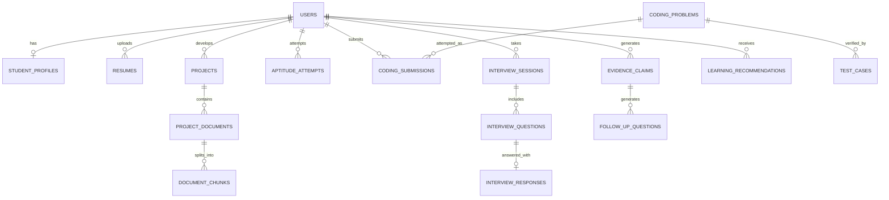
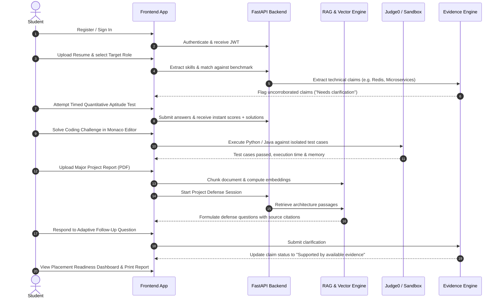

# RAGHire — AI-Powered Placement Preparation Platform

> **Tagline:** *Prepare. Practise. Improve. Get Placement-Ready.*  
> **Platform Scope:** Enterprise Placement & Career Readiness Platform (All Academic Streams)  
> **Key Research Innovation:** Cross-Round Evidence Traceability and Adaptive Follow-Up Engine

---

## 1. Project Overview

**RAGHire** is a full-stack, AI-powered campus recruitment and career readiness platform designed to help candidates across all academic streams (Engineering, Computer Science, Data Science, Management, and Pure Sciences) prepare for the complete recruitment lifecycle. 

Rather than relying on isolated practice quizzes or generic AI chatbots, RAGHire implements:
1. **Retrieval-Augmented Generation (RAG)**: Ingests candidate resumes, project reports, and approved curriculum resources into vector representations to generate context-specific interview questions with verifiable source citations.
2. **Cross-Round Evidence Traceability and Adaptive Follow-Up Engine**: A research-oriented audit graph connecting student claims across resumes, project architecture documentation, coding sandbox submissions, and interview answers. The engine detects unverified claims and asks respectful, non-accusatory follow-up questions to validate practical depth without falsely labeling students as dishonest.
3. **Sandboxed Isolated Code Execution**: Safe Python and Java algorithmic assessment workspace integrating Judge0 with a fallback sandbox emulator.
4. **Multi-Rubric Evaluation**: Evaluates technical and behavioral viva answers across technical correctness, completeness, clarity, relevance, and STAR methodology.

---

## 2. System Architecture Diagram



---

## 3. Database Entity-Relationship (ER) Diagram



---

## 4. End-to-End Workflow Diagram



---

## 5. Ten Functional Modules

1. **Student Profile & Resume Analysis**: PDF/DOCX resume text extraction, skill benchmarking against target roles (Full Stack, Backend, Data/AI, Cloud/DevOps), skill-gap breakdown, editable extractions.
2. **Aptitude Preparation**: Practice categories for Quantitative, Logical, Verbal, and Analytical reasoning with timed mock tests, question palette navigation, score calculation, and step-by-step mathematical explanations.
3. **Coding Assessment**: Monaco code editor for Python and Java, sample inputs/outputs, hidden test cases, Judge0 cloud execution + local isolated sandbox emulator, submission history.
4. **Technical Interview**: Configurable practice rounds across DSA, DBMS, OS, Networks, OOP, and System Design; text or voice input; multi-rubric scoring (correctness, completeness, clarity, relevance).
5. **HR & Communication Practice**: Behavioral and situational interview practice evaluated using the STAR (Situation, Task, Action, Result) methodology with speech-to-text recording.
6. **Project Defense**: Submission of project metadata (architecture, database design, testing, challenges), project report ingestion, challenging viva questions generated by cross-referencing document chunks with source citations.
7. **AI-Based Question Generation & RAG**: Semantic text chunking, dense vector representations, similarity retrieval with strict tenant isolation, prompt injection sanitization.
8. **Cross-Round Evidence Traceability & Adaptive Follow-Up Engine (Core Research)**: Audit registry tracking claims across resumes, project documents, coding submissions, and interviews. Assigns statuses: *Supported by available evidence*, *Needs clarification*, *Not verified from available sources*, *Potentially inconsistent*. Synthesizes polite follow-ups and records clarifications.
9. **Personalized Learning & Recommendations**: Synthesizes test scores and weak areas into a prioritized preparation roadmap with actionable study tasks.
10. **Performance Dashboard & Reports**: Placement Readiness Score gauge, multi-round competency radar chart, progress area chart, printable candidate placement report with objective vs AI evaluation distinctions.

---

## 6. Pre-Seeded Demonstration Accounts

For presentation and review, RAGHire includes one-click demo login buttons:

| Role | Email | Password | Pre-populated Data |
| :--- | :--- | :--- | :--- |
| **Candidate Student** | `student@raghire.edu` | `Student@123` | Active resume, capstone project report, vector chunks, evidence claims, test attempts |
| **Placement Admin** | `admin@raghire.edu` | `Admin@123` | Platform analytics, question bank management, RAG resource management |

---

## 7. Installation & Setup Instructions

### Prerequisites
- Node.js (v18+) and npm
- Python (3.10+)
- Docker & Docker Compose (optional for PostgreSQL container)

### Option A: Local Development Setup (Quickest)

1. **Backend Setup:**
   ```powershell
   cd backend
   python -m venv venv
   .\venv\Scripts\activate
   pip install -r requirements.txt
   # Run database seed
   python -m app.db.seed_data
   # Start FastAPI server
   uvicorn app.main:app --host 127.0.0.1 --port 8000 --reload
   ```

2. **Frontend Setup:**
   ```powershell
   cd frontend
   npm install
   npm run dev
   ```
   Open `http://localhost:5173` in your browser.

3. **Running Automated Tests:**
   ```powershell
   cd backend
   .\venv\Scripts\python -m pytest -v tests
   ```

---

### Option B: Docker Compose Deployment

```bash
docker-compose up --build -d
```
- Frontend UI: `http://localhost:5173`
- Backend API Docs (Swagger): `http://localhost:8000/docs`
- PostgreSQL with pgvector: Port `5432`

---

## 8. Verification & Demonstration Checklist

- [x] **Registration & Login**: Sign in using `student@raghire.edu` or register a new user.
- [x] **Profile & Target Role**: View target roles catalog and customize profile details.
- [x] **Resume Upload**: Upload PDF/DOCX resume, inspect matching/missing skills, and edit extracted details.
- [x] **Aptitude Mock Test**: Take a timed test, navigate using the question palette, and view step-by-step explanations.
- [x] **Coding Workspace**: Solve "Two Sum" or "Longest Substring" in Python/Java, run against sample tests, and submit against hidden test cases.
- [x] **Technical & HR Interview**: Answer viva questions using voice recording or typing; view multi-rubric feedback.
- [x] **Project Defense**: Generate RAG questions referencing the uploaded project report and view document citations.
- [x] **Evidence Traceability Engine**: Review evidence status badges, answer a follow-up question, and verify the updated audit trail.
- [x] **Learning Plan**: Review prioritized study tasks and toggle completion checkboxes.
- [x] **Performance Dossier**: Inspect the multi-round benchmark report and export to PDF.
- [x] **Admin Console**: Log in as `admin@raghire.edu` to review platform metrics and add new aptitude questions.
